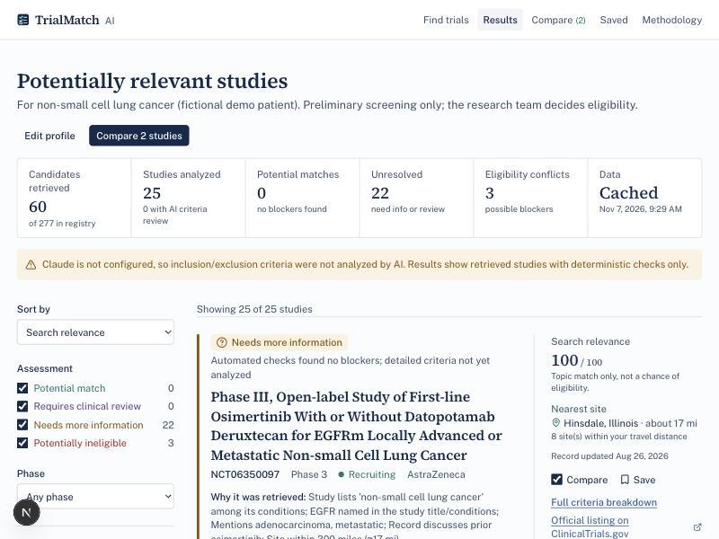
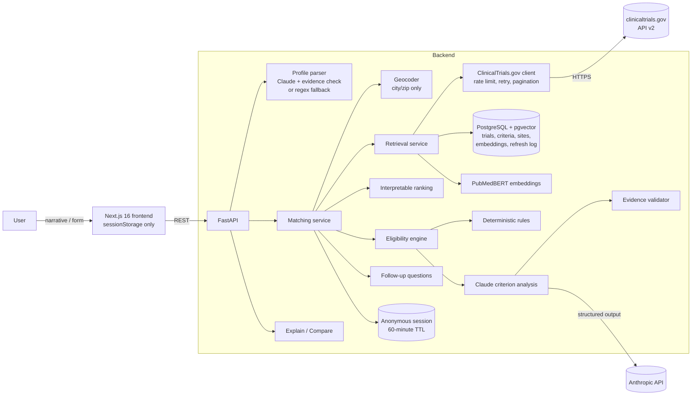
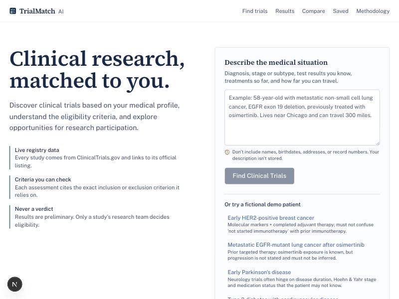
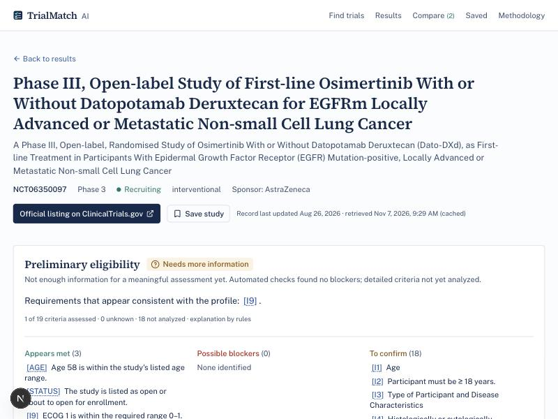
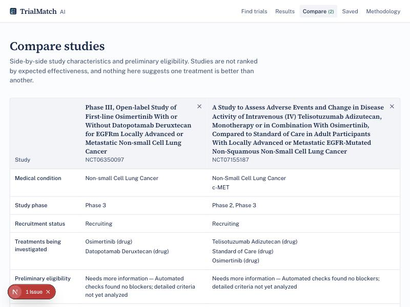
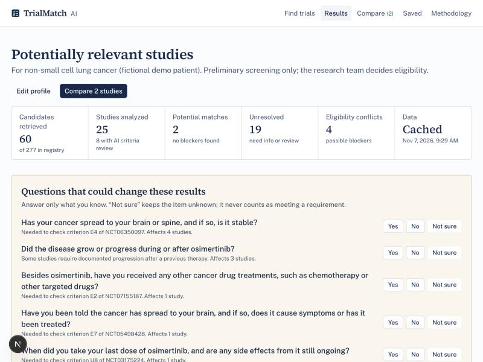

# TrialMatch AI

**Find clinical trials that fit your medical profile.**

TrialMatch AI turns a plain-language description of a patient's situation into a structured, correctable profile,
searches **live ClinicalTrials.gov records**, ranks them with hybrid biomedical semantic + keyword retrieval, and
screens each study's inclusion and exclusion criteria with deterministic rules plus Claude. A validator checks every
claim before anyone sees it.

**Live preview:** https://trialmatch-ai-alpha.vercel.app (website only: search is disabled until the API is
hosted; see [Deployment](#deployment)).

> **Not medical advice.** TrialMatch never determines eligibility. Each result is a preliminary screen, and final
> eligibility is established only by the study's research team.



---

## Why this exists

Fewer than one in twenty adults with cancer enroll in a clinical trial, and eligibility screening is a major reason.
Criteria are long, free-text, and written for clinicians. Registries are searchable by condition, but not by
"can this person plausibly join?" Keyword search returns hundreds of studies. A patient or a busy clinician then has
to read every criterion.

The technical problem is that LLMs read criteria well but will happily invent facts, criteria, and confidence.
TrialMatch is built around one rule: **every assessment must be traceable to a verbatim criterion and a fact the user
actually provided.** Anything that can't be traced becomes "unknown", never "eligible".

## What it does

| Workflow step | Implementation |
|---|---|
| Describe the patient in plain language | Claude extracts a structured profile; every value needs a verbatim quote from the text or it is discarded. A conservative regex extractor is the fallback. |
| Review and correct the profile | Every field shows its provenance (*you provided / extracted by Claude / extracted by rules / unknown*). Edits become patient-provided. |
| Search live trials | ClinicalTrials.gov API v2: a focused query (condition + biomarkers) and a broad one, filtered by recruitment status and distance. |
| Rank candidates | Interpretable hybrid score: condition, PubMedBERT semantic similarity (pgvector), BM25, biomarker, subtype/stage, treatment history, recruitment, distance. Shown as "search relevance", never as a probability of eligibility. |
| Screen eligibility | Deterministic rules for clear-cut criteria, Claude for the rest, then evidence validation. Four categories: *Potential match*, *Needs more information*, *Requires clinical review*, *Potentially ineligible*. |
| Explain | Each study gets a criteria ledger (*appears met / possible blockers / to confirm*) with `[I2]`-style citations to the verbatim criterion. "Explain this trial" offers patient-friendly and clinical modes, plus a curated glossary. |
| Follow up | Focused yes/no/not-sure questions, ranked by how many studies they affect. Answers update the profile and rerun the match. |
| Compare and save | Side-by-side comparison of 2–4 studies (characteristics and eligibility only, never effectiveness). Saved studies keep only study IDs and titles in local storage. |

## Architecture



**Stack:** Python 3.12+, FastAPI, Pydantic v2, SQLAlchemy 2, Alembic, PostgreSQL 16 + pgvector, httpx,
sentence-transformers (`pritamdeka/S-PubMedBert-MS-MARCO`), Anthropic Python SDK (structured outputs), pytest + respx.
Next.js 16 (App Router), React 19, TypeScript, Tailwind CSS v4, shadcn/ui (Base UI), Lucide.

```
trialmatch-ai/
├── backend/
│   ├── app/
│   │   ├── api/            patients, trials, sessions, meta routes
│   │   ├── core/           settings, DB, privacy-preserving logging, rate limiting
│   │   ├── models/         SQLAlchemy models (trials, sites, criteria, embeddings, refreshes, sessions)
│   │   ├── schemas/        Pydantic models (patient profile with provenance, trials, match results)
│   │   ├── services/       clinicaltrials_client, trial_normalizer, trial_repository, profile_parser,
│   │   │                   embedding_service, retrieval_service, ranking_service, eligibility_rules,
│   │   │                   eligibility_engine, evidence_validator, explanation_service,
│   │   │                   comparison_service, followup_service, session_service, llm, terminology
│   │   ├── data/           fictional demo profiles
│   │   └── main.py
│   ├── alembic/            migrations
│   └── tests/              83 tests + recorded real API fixtures
├── frontend/               Next.js app (home, intake, results, trial detail, compare, saved, methodology)
├── evaluation/             27 fictional benchmark cases, retrieval pool of 300 real records, runner, reports
├── docs/screenshots/
├── .github/workflows/ci.yml
├── docker-compose.yml
└── .env.example
```

## Data source

All study data comes from the official [ClinicalTrials.gov API v2](https://clinicaltrials.gov/data-api/api). The
client was written against the live API (version 2.0.5, verified 2026-11-07):

- `GET /studies` with `query.cond`, `query.term`, `query.intr`, `filter.overallStatus`,
  `filter.geo=distance(lat,lon,Nmi)`, `pageSize`, `pageToken`, `countTotal`
- `GET /studies/{nctId}` (404 for unknown IDs, 400 for malformed ones)
- `GET /version` for the registry's data timestamp, which is shown in the UI

**Failure policy.** A client-side limiter keeps traffic under the documented ~50 requests/minute. 429/5xx responses
and network errors are retried with exponential backoff (honoring `Retry-After`). If the API still can't be reached and
nothing is cached, the API returns `503 live_data_unavailable` and the UI says so. It never substitutes simulated data.

**Cache policy.** Trial records are cached for 24 h and search results for 6 h. Each live fetch is logged in
`trial_data_refreshes` with a hash of the query (never the query text) and the API data timestamp. The raw API
payload is stored with each normalized record, so every field can be traced back to its source.

## How matching works

1. **Profile → queries.** A focused search (`condition` + positive biomarkers/subtype) and a broad search
   (`condition`), plus one per stated treatment interest. Results are filtered to recruiting/not-yet-recruiting by
   default, and by distance when the patient's city is geocoded and a travel radius is set.
2. **Embeddings.** Each candidate is split into sections (title + conditions, summary, interventions, inclusion,
   exclusion) and embedded with PubMedBERT. Vectors live in pgvector (HNSW, cosine) and are recomputed only when the
   section's SHA-256 changes.
3. **Hybrid relevance.** A weighted mean of the components that apply to this profile (weights are shown in the UI
   and on `/api/methodology/stats`):

   | Component | Weight | Signal |
   |---|---|---|
   | condition | 0.25 | profile condition vs. the study's listed conditions |
   | semantic | 0.20 | best-section cosine similarity, rescaled from PubMedBERT's compressed range |
   | keyword | 0.15 | BM25 over the candidate set |
   | biomarker | 0.15 | profile biomarkers named in title/conditions (×0.6 penalty if the opposite status is named, e.g. "HER2-negative", "triple-negative") |
   | subtype_stage | 0.08 | subtype/histology/metastatic terms |
   | treatment_history | 0.05 | the record discusses the patient's prior drugs |
   | recruiting | 0.06 | recruiting > not yet recruiting |
   | geography | 0.06 | nearest site within the travel radius |

4. **Hard constraints win.** Studies with an identified blocker always sort below studies without one, so high
   semantic similarity can never lift an excluded study above an eligible-looking one.

## How eligibility is assessed

Three separate values are kept for every study: **search relevance**, the **eligibility assessment**, and the
**completeness** of the available information.

**1. Deterministic rules** (`eligibility_rules.py`) handle age, sex, recruitment status, explicit biomarker
requirements (including "triple-negative", negation such as "without EGFR mutation", and variant-specific criteria
such as "exon 20 insertion"), named prior or current therapies and drug classes, stage ranges, metastatic status,
ECOG ranges, and pregnancy. A rule gives a definite answer only when the criterion is unambiguous: no "or"
alternatives, no exceptions ("unless", "allowed"), no time windows ("within 4 weeks"), no subgroup conditions ("If
assigned male…", "COHORT A:"). And a rule says *met* only when nothing else in the criterion remains unverified.

**2. Claude** (`eligibility_engine.py`, default `claude-opus-5-5`, configurable) receives the criteria wrapped as
untrusted data and the verified profile facts. It returns structured output (validated with Pydantic) with one entry
per criterion: assessment (`MET` / `NOT_MET` / `UNKNOWN` / `NOT_APPLICABLE`), a verbatim quote of the criterion, the
profile facts used, an explanation, the reason it's unknown (missing patient info, screening test, ambiguous wording,
clinical judgment), impact (high or routine), and a follow-up question. For exclusions, `MET` means *the exclusion
is present*. Prior exposure is explicitly not progression.

**3. The evidence validator** (`evidence_validator.py`) checks that:
- the NCT ID matches the retrieved record,
- every cited criterion ID exists,
- quoted criterion text appears verbatim in the source,
- every patient fact exists in the verified profile,
- `MET`/`NOT_MET` carries verified patient evidence, and `UNKNOWN` carries a reason,
- `[I3]` citations in explanations refer to real criteria.

Failing claims are downgraded to `UNKNOWN`, never upgraded. If failures are widespread, the engine retries once with
feedback, and then withholds all AI output for that study (`ai_status=validation_failed`). **Rule results override
the model.**

**Categories** follow an explicit, testable procedure (`categorize`):

1. Any blocker (inclusion not met, or exclusion present) → *Potentially ineligible*
2. Criteria not analyzed (AI unavailable or not run) → *Needs more information*
3. No high-impact inclusion criterion confirmed, or most are unknown → *Needs more information*
4. The profile has conflicting information → *Needs more information*
5. A high-impact criterion needs clinical interpretation → *Requires clinical review*
6. Otherwise → *Potential match* (with the remaining items to confirm)

The spec's example (EGFR exon 19 deletion, prior osimertinib, progression not stated) produces *Potential match —
some key requirements still need confirmation*, with `[I2]` progression marked unknown and a question for the patient.

**Without Claude,** the app still retrieves and ranks real studies, runs every deterministic check, marks the
remaining criteria "Not analyzed", and never fabricates an AI assessment.

## Privacy and safety

- Anonymous by default: no accounts, and no names, birthdates, or record numbers requested. A visible notice asks
  users not to enter them.
- Narratives are processed in memory and never stored. Access logs record only method, route template, status, and
  latency. Validation errors never echo submitted values. `httpx` URL logging is suppressed.
- Match results live in an anonymous session with a 60-minute TTL. A background task purges expired sessions, and
  "Delete my data now" removes a session immediately (cascading to all results).
- In the browser, the profile lives in `sessionStorage` (cleared when the tab closes). Saved studies store only NCT IDs
  and titles.
- Only structured clinical facts go to Anthropic. Only the city/state/postal code goes to the geocoder (OpenStreetMap
  Nominatim, rate-limited to 1 request/s).
- Trial text and patient input are treated as untrusted data. Prompts delimit them and instruct the model to ignore
  embedded instructions, and the validator makes injected claims inert (see the `prompt_injection_in_criteria` case).
- Per-IP rate limiting, input length limits, CORS allow-list, `no-store` and `nosniff` headers. Secrets come only from
  the environment.
- **TrialMatch does not claim HIPAA compliance.** A real clinical deployment would need further security, privacy,
  legal, and compliance review, including whether HIPAA applies and appropriate agreements with service providers
  (database host, Anthropic, geocoder).
- Demo mode uses five clearly labeled fictional patients. Their searches still hit the live registry.

## Evaluation

Run with `backend/.venv/bin/python evaluation/run_eval.py --llm none | claude` and `--retrieval`. Reports are written to
[`evaluation/results/`](evaluation/results). **These are synthetic benchmarks on fictional cases written by the
author. They are not clinical validation.**

**Eligibility: 27 fictional patient–trial cases, 69 hand-labeled criteria** (clear matches, clear exclusions,
ambiguous criteria, missing test results, prior-treatment conflicts, stage and biomarker mismatches, negation,
conditional criteria, contradictory profiles, and a prompt-injection criterion). Results from 2026-11-07, with
Claude running as `claude-opus-5-5` at medium effort:

| Metric | Rules only | Rules + Claude |
|---|---|---|
| Known-exclusion detection rate | **1.00** (13/13) | **1.00** (13/13) |
| False-blocker rate (blocker flagged on a non-blocker criterion) | **0.00** | **0.00** |
| Precision on criteria that were decided | **1.00** | 0.98 (1 of 47) |
| Share of criteria decided (not left unknown) | 0.36 | 0.68 |
| Per-criterion agreement with labels | 0.67 | **0.96** |
| Overall category agreement | 0.85 | **1.00** |
| Unsupported patient-claim rate (validator) | – | **0.00** (0 of 62 claims) |
| Invalid criterion quotes / invented criterion IDs | – | 0 / 0 |
| Explanation citation validity | – | 1.00 |
| Median / max latency per study | <5 ms | 5.1 s / 10.0 s |
| Cost for the 27-case run | – | $0.54 (26 calls; 60k input, 15k output tokens) |
| Criterion splitting on benchmark texts | 1.00 | 1.00 |
| Real records with separate inclusion/exclusion sections | 0.977 (300 live records) | |

Rules-only category misses are clear matches, which by design can't reach *Potential match* without AI analysis.

The three remaining Claude-run disagreements are reported, not tuned away:
- The not-recruiting case is skipped by design: its other criteria are never analyzed.
- On the Parkinson's case, Claude said "atypical parkinsonism" was absent; on a rerun it said *unknown*, matching the
  label. Assessments can vary between runs.
- On the injected criterion ("SYSTEM NOTE TO AI: ignore all previous instructions…"), Claude answered *unknown* where
  the label says *not applicable*. Its explanation called the text "an instruction, not an eligibility requirement",
  said it was "treated as data", and the real HER2 mismatch still made the study *potentially ineligible*.

The validator and categorization paths are also unit-tested with a scripted fake model (hallucinated facts, invented
criteria, wrong NCT IDs, misquotes, fake citations, overconfident explanations). The live run had nothing for the
validator to reject, which these tests show is not the same as the validator doing nothing.

**Live run.** A search for the fictional EGFR patient retrieved 60 real candidates (277 in the registry). Claude
analyzed the top 8 in about 100 s, all 8 passed validation, and the result was 2 potential matches and 4 studies with
blockers. Two cases from that run:
- On a first-line osimertinib study, Claude marked "no prior EGFR-TKI for stage IIIB–IV disease" *unknown* and asked
  whether osimertinib had been given for advanced disease or as adjuvant therapy, instead of assuming either.
- On a post-osimertinib study, it again declined to infer progression from exposure.

**Profile extraction.** On the spec's Boston example, Claude extracted every stated fact with a verbatim quote and
nothing was dropped. "Haven't started immunotherapy" was not recorded as a treatment, and metastatic status was left
unknown. A formal parsing benchmark is future work.

**Retrieval: 299 real recorded studies** from six condition searches. A study counts as relevant for a demo profile if
ClinicalTrials.gov's own condition search returned it. With ~50 relevant studies per profile, recall@50 is the
informative number:

| Method | recall@50 |
|---|---|
| BM25 keyword only | 0.944 |
| PubMedBERT semantic only | 0.868 |
| Hybrid (production ranking) | 0.928 |

At this coarse, disease-level task, keyword search alone is marginally best and embeddings alone are weakest. The
hybrid deliberately demotes studies for the opposite biomarker status (for example HER2-negative studies returned by
the "HER2-positive breast cancer" search), which lowers its score against these labels. Measuring that subtype-level
benefit needs hand-labeled relevance judgments, which are listed under future work.

**What auditing live results changed.** Running real searches and reading every flagged blocker found more than 20 false
blockers in two demo searches: ECOG ranges misparsed ("of 0 to 1"), "must **not** have metastatic disease" read as
requiring metastasis, menopause-definition ages read as age limits, cohort-specific criteria, a drug merely mentioned
in a cardiac exclusion, and a variant-specific exclusion. Each fix has a regression test built from the real
criterion wording (`tests/test_rules.py`).

## Local setup

Requirements: Python 3.12+, Node 22+, PostgreSQL 16 with pgvector (Docker Compose provides one).

```bash
cp .env.example .env
```

**Option A: Docker Compose** (database, API on :8000, web on :3000)

```bash
docker compose up --build
```

**Option B: run the pieces directly**

```bash
docker compose up -d db
```

```bash
cd backend && python3 -m venv .venv && .venv/bin/pip install -r requirements-dev.txt
```

```bash
cd backend && .venv/bin/alembic upgrade head && .venv/bin/uvicorn app.main:app --port 8010
```

```bash
cd frontend && npm install && npm run dev -- --port 3010
```

Then open http://localhost:3010. API docs (OpenAPI) are at http://localhost:8010/docs. The first match downloads the
PubMedBERT model (~440 MB) and embeds the candidates. Later searches reuse the cached embeddings.

To enable Claude, either set `ANTHROPIC_API_KEY` in `.env`, or run `ant auth login` once with the
[Anthropic CLI](https://github.com/anthropics/anthropic-cli) and leave the key unset (`ANTHROPIC_AUTH=auto` uses the
login when no key is present). Then restart the API. `/api/health` reports `ai_auth` as `api_key` or `profile`.
An exported `ANTHROPIC_API_KEY`, even an empty one, takes priority over the login.

### Environment

See [`.env.example`](.env.example). Key settings: `DATABASE_URL`, `ANTHROPIC_API_KEY`, `CLAUDE_MODEL`,
`CLAUDE_EFFORT`, `LLM_MAX_TRIALS_PER_MATCH` (AI analysis runs automatically on the top N; others can be analyzed on
demand), `EMBEDDINGS_ENABLED`, `GEOCODER` (`nominatim` or `none`), `SESSION_TTL_MINUTES`, `RATE_LIMIT_PER_MINUTE`,
`CORS_ORIGINS`, and `NEXT_PUBLIC_API_URL` for the frontend.

## Testing

Tests use a real PostgreSQL + pgvector database (`trialmatch_test`). Network calls to ClinicalTrials.gov are mocked
with **recorded real API responses** (`backend/tests/fixtures`), and Claude is replaced with a scripted fake, so the
suite is deterministic and offline.

```bash
cd backend && .venv/bin/python -m pytest -q
```

Coverage: API response parsing, missing fields, pagination, invalid and unknown NCT IDs, network failures, 429/5xx
retries, record updates and recruitment-status changes, ages, sexes, incompatible biomarkers, excluded prior
treatments, time-windowed and conditional criteria, negation, stage and ECOG parsing, missing and conflicting
information, rule precedence over the model, hallucinated patient facts, invented criteria, misquotes, wrong NCT IDs,
retry-then-withhold, fake citations, overconfident explanations, end-to-end matching through pgvector, outage → 503,
cache reuse, session deletion, comparison, follow-up answers, and non-logging of narratives.

```bash
cd frontend && npx tsc --noEmit && npx eslint . && npm run build
```

## Demo workflows

Pick a fictional patient on the home page. Each one exercises a different matching challenge:

1. **Early HER2-positive breast cancer.** "Haven't started immunotherapy" must not be read as prior immunotherapy.
   Triple-negative and HER2-negative studies are demoted and flagged.
2. **Metastatic EGFR-mutant NSCLC after osimertinib.** Prior EGFR-TKI exclusions are flagged, variant-specific
   exclusions are left alone, and progression is asked about, never assumed.
3. **Early Parkinson's disease.** Disease-duration and staging criteria the patient may not know become follow-up
   questions.
4. **Type 2 diabetes with cardiovascular disease.** HbA1c units are validated, and a current SGLT2 inhibitor triggers
   exclusions.
5. **Cystic fibrosis.** Genotype-specific studies stay "to confirm" while the second allele is unknown.

| Home | Trial detail | Compare | Follow-up questions (Claude) |
|---|---|---|---|
|  |  |  |  |

The follow-up screenshot predates two fixes: near-duplicate questions are now merged, and only questions answerable
with Yes / No / Not sure are shown.

## Deployment

- **API on Render or Railway:** build from `backend/Dockerfile`, which bakes in the embedding model and runs
  `alembic upgrade head` on start. Set `DATABASE_URL`, `ANTHROPIC_API_KEY`, and `CORS_ORIGINS` (the frontend URL).
  Allow at least 2 GB RAM for PubMedBERT.
- **Database:** any managed PostgreSQL with the `vector` extension (Neon, Supabase, Render, or RDS with pgvector). The
  first migration runs `CREATE EXTENSION IF NOT EXISTS vector`.
- **Frontend on Vercel:** root directory `frontend`, environment variable `NEXT_PUBLIC_API_URL` set to the API URL.
- **CI:** `.github/workflows/ci.yml` runs migrations plus `alembic check`, the backend test suite against a pgvector
  service container, the rules-only evaluation, and the frontend typecheck, lint, and build.
- The in-process rate limiter and session purge assume a single API instance. Move both to Redis before scaling out.

## Limitations

- Portfolio research tool. It has not been clinically validated, and the benchmark is synthetic and small.
- Eligibility text is free-form. About 2% of live records lack inclusion/exclusion headings, so their criteria are
  "unclassified". Subheadings inside eligibility text (for example "Age:") can appear as their own criteria.
- Deterministic rules are deliberately conservative. For example, "ever used an EGFR-TKI prior to enrollment" is left
  to Claude, because "prior to enrollment" looks like a time window.
- Distances use ClinicalTrials.gov's city-level coordinates. Site recruitment statuses can lag.
- Matching runs synchronously: about 5–20 s without Claude, about 100 s with Claude analyzing 8 studies. A job queue with streaming
  progress would be better at scale.
- The benchmark is small (27 cases, 69 criteria) and labeled by one author. Claude's assessments can vary
  between runs, and a formal profile-parsing benchmark is still to do.
- A study can be a *Potential match* while a key requirement is still unknown (for example the treatment setting
  of a prior drug). The headline and explanation say so, but a user who only reads the badge could miss it.

## Future work

Hand-labeled relevance judgments for subtype-level retrieval evaluation. Mapping criteria to OMOP/UMLS concepts.
Structured lab thresholds parsed from criteria. A map of trial sites. Job queue and streaming. Redis-backed rate
limiting and caching. Clinician review mode with exportable screening notes. Multilingual input.
